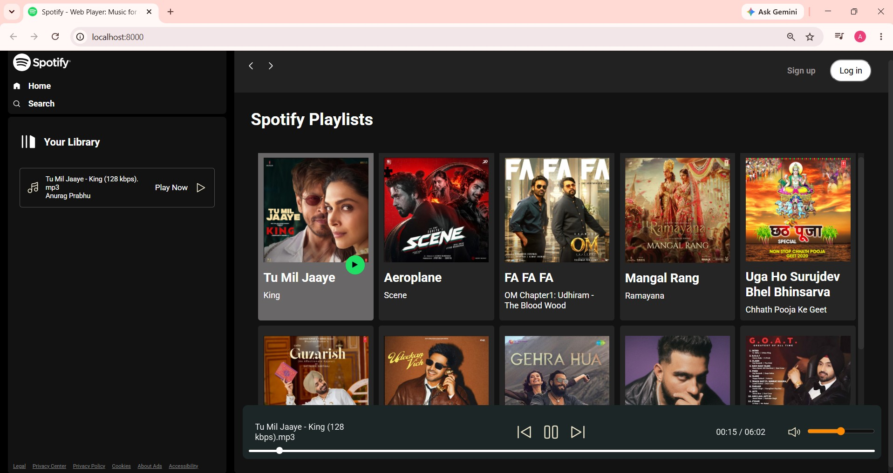

# Project Spotify Clone

A browser-based music player built as a front-end portfolio project. Browse playlists and control playback with a responsive interface. This is an independent project and is not affiliated with Spotify.

## Tech stack

- HTML
- CSS
- JavaScript

## Run locally

1. Clone the repository and enter the project folder:

   ```bash
   git clone https://github.com/Anurag718/Project-Spotify-Clone.git
   cd Project-Spotify-Clone
   ```

2. Add at least one MP3 to the default playlist folder: `songs/S1 - Tu Mil Jaaye/`. The full path is `<cloned-project-folder>\songs\S1 - Tu Mil Jaaye\`. Add MP3 files to the corresponding folder for any other playlist you want to play. Each playlist folder needs an `info.json` and `cover.jpg`.

   Example:

   ```text
   songs/
     S1 - Tu Mil Jaaye/
       track.mp3
       info.json
       cover.jpg
   ```

   The playlist metadata and cover are included. Use only music you own or are licensed to redistribute.

3. Start a local server from the project root:

   ```bash
   py -m http.server 8000
   ```

4. Open [http://localhost:8000](http://localhost:8000).

## Preview


